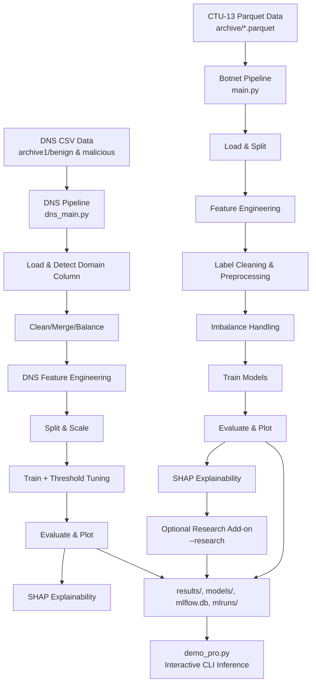
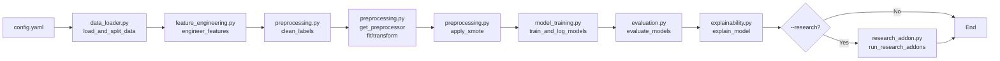
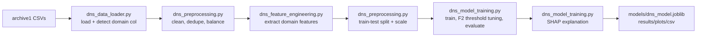

# Machine Learning-Based Detection of DNS Tunneling and Botnet Activities

## Project Overview
This project implements a modular, script-based machine learning system for network threat detection with two primary pipelines:

- **Botnet detection** on CTU-13 NetFlow/binetflow data (`.parquet`) using flow-level behavioral features.
- **DNS tunneling detection** on DNS query/domain datasets (`.csv`) using domain-string and lexical/statistical features.

The repository includes data loading, preprocessing, feature engineering, model training, evaluation, explainability (SHAP), experiment/result artifacts, MLflow tracking artifacts, and a CLI demo for interactive inference.

## Problem Statement
Malicious network activity such as botnet communication and DNS tunneling can be difficult to detect with static rules because attackers may mimic benign traffic patterns or encode data in DNS queries. This project applies supervised machine learning to classify:

- **Botnet vs. Normal** network flows (binary classification from CTU-13 labels).
- **Malicious DNS tunneling vs. Benign DNS** traffic (binary classification).

## Project Objectives
- Build reproducible ML pipelines for botnet and DNS tunneling detection.
- Engineer domain-relevant behavioral and lexical features from network/DNS data.
- Train and compare multiple classifiers for each task.
- Evaluate models using classification metrics and visual diagnostics (confusion matrix, ROC/PR curves).
- Provide model explainability using SHAP where available.
- Support configurable botnet experiments and artifact generation for analysis/reporting.

## Key Features
- **Two detection pipelines**: Botnet (`main.py`, `src/*`) and DNS tunneling (`dns_main.py`, `src/dns_*`).
- **Config-driven botnet pipeline**: Dataset path/split strategy, feature lists, imbalance strategy, model selection, MLflow URI, and evaluation options via `config.yaml`.
- **Data handling**:
  - Parquet ingestion and memory downcasting for botnet data (`src/data_loader.py`).
  - CSV ingestion and domain-column auto-detection for DNS data (`src/dns_data_loader.py`).
- **Feature engineering**:
  - Botnet: derived flow rates/ratios (`bytes_per_sec`, `packets_per_sec`, `bytes_per_packet`).
  - DNS: domain lexical/statistical features including Shannon entropy, lengths/counts, digit ratio, unique chars, longest label.
- **Preprocessing**:
  - Botnet: label normalization to binary, median/mode imputation, standard scaling, one-hot encoding, optional SMOTE.
  - DNS: cleaning, deduplication, balanced sampling, stratified train-test split, standard scaling.
- **Model training & comparison**:
  - Botnet (configurable): `RandomForest`, `LogisticRegression` (optionally `GradientBoosting`, `XGBoost`, `IsolationForest` listed in config/comments/code support varies).
  - DNS: `RandomForest`, `GradientBoosting`, `LogisticRegression` with F2-score-based threshold tuning (recall-focused).
- **Evaluation artifacts**: CSV comparisons, confusion matrices, ROC/PR curves, SHAP summary plots, and logs.
- **Experiment tracking**: MLflow logging for botnet training/evaluation (`sqlite:///mlflow.db`, `mlruns/` present).
- **Research add-on (`--research`)**: Ablation study, latency measurement, model-size/statistical test outputs, DoH analysis text, and a lightweight cross-dataset check output.
- **Interactive demo**: `demo_pro.py` provides a menu-driven CLI for DNS and botnet predictions using saved models.

## Technologies and Libraries Used
From `requirements.txt` and source code:
- **Python**, **pandas**, **NumPy**
- **scikit-learn** (pipelines, preprocessing, models, metrics, splitting)
- **imbalanced-learn** (SMOTE)
- **XGBoost** (dependency listed; supported in botnet model factory code path when enabled)
- **PyArrow / fastparquet** (Parquet reading support)
- **Matplotlib**, **Seaborn** (plots)
- **SHAP** (explainability)
- **PyYAML** (config loading)
- **MLflow** (experiment tracking)
- **Joblib** (model persistence)
- Standard library: `logging`, `os`, `glob`, `argparse` (imported), `math`, `time`, `pickle`, etc.

## Project Architecture / Workflow

### Overall Repository Workflow


### Botnet Pipeline (`main.py`)


### DNS Tunneling Pipeline (`dns_main.py`)


## Project Directory Structure
```text
CourseProject/
├── archive/                         # CTU-13 parquet files (botnet dataset inputs)
├── archive1/                        # DNS datasets
│   ├── benign/
│   │   └── benign.csv
│   └── malicious/
│       ├── dns2tcp.csv
│       └── iodine.csv
├── mlruns/                          # MLflow run artifacts (present)
├── models/                          # Saved trained models (.joblib)
├── results/                         # Generated outputs (CSV, plots, logs/text reports)
│   ├── results_botnet/
│   └── results_dns/
├── src/                             # Core pipeline modules
│   ├── data_loader.py               # Botnet parquet loading & split
│   ├── preprocessing.py             # Botnet label cleaning, preprocessing, SMOTE
│   ├── feature_engineering.py       # Botnet derived features
│   ├── model_training.py            # Botnet model creation/training/MLflow logging
│   ├── evaluation.py                # Botnet evaluation & plots
│   ├── explainability.py            # Botnet SHAP explainability
│   ├── research_addon.py            # Optional research analyses
│   ├── utils.py                     # Logging/config helpers
│   ├── dns_data_loader.py           # DNS CSV loading & domain-column detection
│   ├── dns_preprocessing.py         # DNS cleaning/balancing/split/scaling
│   ├── dns_feature_engineering.py   # DNS domain feature extraction
│   └── dns_model_training.py        # DNS training, threshold tuning, evaluation, SHAP
├── config.yaml                      # Botnet pipeline configuration
├── main.py                          # Botnet pipeline entrypoint
├── dns_main.py                      # DNS tunneling pipeline entrypoint
├── demo_pro.py                      # Interactive CLI demo (DNS + botnet inference)
├── pipeline_flowchart.md            # Mermaid flowchart/documentation notes
├── pipeline.log                     # Existing pipeline log artifact
├── mlflow.db                        # SQLite MLflow tracking database (present)
├── requirements.txt                 # Python dependencies
└── README.md                        # Project documentation
```

> Note: `__pycache__/` and compiled `.pyc` files are present in the workspace but are runtime artifacts, not source modules.

## Dataset Description

### Botnet Dataset (`archive/`)
- **Format**: Parquet files (CTU-13 binetflow-style files, e.g. `1-Neris-20110810.binetflow.parquet`, etc.).
- **Location**: `archive/`
- **Observed in workspace**: 13 parquet files with varying file sizes (examples: `1-Neris-20110810.binetflow.parquet`, `13-Virut-20110815-3.binetflow.parquet`).
- **Usage in code**:
  - Loaded via `pandas.read_parquet(..., engine="pyarrow")`.
  - Split strategy configurable (`file` or `row`) in `config.yaml`.
  - Target column configured as `label` (`config.yaml`).
  - Labeling logic treats records containing `Botnet` in `label` as class `1`, others as `0`.
- **Configured features (botnet)**: numerical `dur`, `tot_pkts`, `tot_bytes`, `src_bytes`; categorical `proto`, `state`, `dir`; drop `family`.

> Detailed schema/row counts were not exhaustively extracted in this environment because Parquet inspection tooling (`pyarrow`) was not installed in the current runtime. Dataset files were not modified.

### DNS Dataset (`archive1/`)
- **Format**: CSV files.
- **Locations**:
  - `archive1/benign/benign.csv`
  - `archive1/malicious/dns2tcp.csv`
  - `archive1/malicious/iodine.csv`
- **Observed columns (sampled headers)** include: `flow_id`, timestamps, IP/port fields, DNS/domain fields (e.g. `dns_domain_name`, `dns_top_level_domain`, `dns_domain_name_length`, n-grams/entropy-related columns), TTL/record fields, and `label`.
- **Labels (raw)**: `Benign` / `Malicious` in sampled rows.
- **Usage in code**:
  - DNS pipeline auto-detects a domain column from common names/substrings (e.g. `query`, `qname`, `domain`, `fqdn`, `dns_domain_name`) and validates sample values.
  - Benign labeled `0`, malicious sources (`dns2tcp`, `iodine`) labeled `1`.
  - Datasets are cleaned, deduplicated, merged, and balanced by sampling (target 50,000 per class; capped by available data).

## Data Preprocessing and Feature Engineering

### Botnet Pipeline
**Feature engineering (`src/feature_engineering.py`)**
- Replaces zero `dur` and `tot_pkts` with small values to avoid division by zero.
- Creates derived behavioral features:
  - `bytes_per_sec = tot_bytes / dur`
  - `packets_per_sec = tot_pkts / dur`
  - `bytes_per_packet = tot_bytes / tot_pkts`
- Dynamically appends derived features to numerical feature list (if missing).
- Replaces infinities with `NaN`.

**Label cleaning & preprocessing (`src/preprocessing.py`)**
- Binary label creation: `binary_label = 1` if `label` contains `Botnet` (case-insensitive), else `0`.
- Drops configured columns (e.g. `family`) and original target column.
- Drops rows with null `binary_label`.
- Preprocessing pipeline (`ColumnTransformer`):
  - Numerical: median imputation + `StandardScaler`
  - Categorical: most-frequent imputation + `OneHotEncoder(handle_unknown='ignore', sparse_output=False)`
- Imbalance handling: `apply_smote(...)` applies SMOTE when `preprocessing.imbalance_strategy == "smote"`; otherwise no resampling.

**Splitting & loading (`src/data_loader.py`)**
- Discovers `*.parquet` files in configured data directory.
- Optional file limit (`max_files`).
- Split modes:
  - `row`: concatenates files and performs stratified train-test split by temporary botnet/non-botnet label.
  - `file`: file-based split (with fallback to row split for single file).
- Performs numeric downcasting for memory optimization.

### DNS Pipeline
**Loading & domain detection (`src/dns_data_loader.py`)**
- Loads benign and malicious CSVs and assigns labels (`0`/`1`).
- Auto-detects domain column (exact/substring matching against common domain field names) and logs sample values.

**Cleaning & balancing (`src/dns_preprocessing.py`)**
- Drops null domain rows and duplicate domains (per dataset; malicious merged then deduplicated again).
- Converts domain column to string.
- Samples/merges to create a balanced dataset (target 50,000 benign + 50,000 malicious when available), then shuffles.
- Performs stratified 80/20 train-test split and applies `StandardScaler` to engineered feature columns.

**Feature engineering (`src/dns_feature_engineering.py`)**
Extracted features from detected domain column:
- `domain_length`
- `num_subdomains` (count of `.`)
- `entropy` (Shannon entropy, manually computed)
- `num_digits`
- `digit_ratio` (`num_digits / domain_length`, safe for empty/zero length)
- `unique_char_count`
- `longest_label_length` (max token length split by `.`)

## Machine Learning Models and Algorithms

### Botnet Detection (`src/model_training.py`, `config.yaml`)
Implemented/available model options in code:
- **RandomForestClassifier** (`n_estimators=100`, `class_weight='balanced'`, `n_jobs=-1`)
- **GradientBoostingClassifier** (`n_estimators=100`)
- **LogisticRegression** (`max_iter=1000`, `class_weight='balanced'`)
- **XGBoost** and **IsolationForest** are referenced in config/comments and evaluation/explainability logic paths exist in parts of the codebase; current default training list in `config.yaml` enables `RandomForest` and `LogisticRegression`.

Notes:
- Botnet training code enforces `class_weight='balanced'` for supported classifiers in `get_models(...)`.
- Models are trained on preprocessed (and optionally SMOTE-resampled) arrays; saved via Joblib.
- MLflow tracking is configured (`sqlite:///mlflow.db`) and used for run logging/artifacts/metrics.

### DNS Tunneling Detection (`src/dns_model_training.py`)
Trained and compared:
- **RandomForestClassifier** (`n_estimators=100`)
- **GradientBoostingClassifier** (`n_estimators=100`)
- **LogisticRegression** (`max_iter=1000`)

Additional technique:
- **Recall-focused threshold tuning** using Precision-Recall curve thresholds and selecting the threshold that maximizes **F2 score** (`β=2`) per model before computing reported metrics/predictions.

## Model Training and Evaluation

### Botnet Evaluation (`src/evaluation.py`)
For each trained model (non-IsolationForest path):
- Uses predicted probabilities (`predict_proba`) with a default threshold of `0.5`.
- Computes and logs: `Accuracy`, `Precision`, `Recall`, `F1`, `FPR`, `ROC_AUC` (and confusion matrix counts in logs).
- Generates plots:
  - Precision-Recall curve (`*_pr_curve.png`)
  - ROC curve (`*_roc_curve.png`)
  - Confusion matrix (`*_confusion_matrix.png`)
- Exports comparison CSV to `results/model_comparison.csv` (when enabled).
- Attempts to log metrics back to corresponding MLflow runs.

Explainability (`src/explainability.py`):
- Generates SHAP summary plots when enabled in config (`evaluation.plot_shap: true`).
- Uses `TreeExplainer` for tree models and `LinearExplainer` for Logistic Regression on a sampled subset (up to 1000 rows).

### DNS Evaluation (`src/dns_model_training.py`)
For each model:
- Tunes decision threshold by maximizing F2 score from PR curve.
- Computes: `Accuracy`, `Precision`, `Recall`, `F1_Score` (at tuned threshold).
- Saves artifacts to `results/`:
  - `dns_model_comparison.csv`
  - `cm_<Model>.png`
  - `roc_curve_comparison.png`
  - `pr_curve_comparison.png`
- Selects and saves the best model (by highest F2 score across models) as `models/dns_model.joblib`.
- Generates SHAP summary plot (sampled subset, 1000 rows) when SHAP is available.

### Optional Research Add-on (Botnet, `--research`)
`src/research_addon.py` writes additional outputs to `results/`:
- `ablation_study.csv` (simple comparison using a reduced feature subset vs current pipeline)
- `cross_dataset_results.csv` (lightweight placeholder/check based on available label-family columns)
- `latency.txt` (single and batch prediction timing)
- `model_size.txt` (serialized model size)
- `statistical_test.txt` (bootstrap-style repeated F1 estimates summary)
- `doh_analysis.txt` (textual analysis of DNS-over-HTTPS implications)

## Performance Metrics and Results (Verified from Existing Outputs)

### Botnet Model Comparison (from `results/results_botnet/model_comparison.csv`)
| Model | Threshold | Recall | F1 Score | Precision | Accuracy | FPR | ROC AUC |
|---|---:|---:|---:|---:|---:|---:|---:|
| RandomForest | 0.5 | 0.8386 | 0.6931 | 0.5907 | 0.9863 | 0.0110 | 0.9840 |
| LogisticRegression | 0.5 | 0.8869 | 0.1234 | 0.0663 | 0.7668 | 0.2354 | 0.8970 |

### DNS Model Comparison (from `results/results_dns/dns_model_comparison.csv`)
| Model | Threshold | Accuracy | Precision | Recall | F1 Score |
|---|---:|---:|---:|---:|---:|
| Random_Forest | 0.35 | 0.9979 | 0.9964 | 0.9994 | 0.9979 |
| Gradient_Boosting | 0.7533 | 0.99695 | 0.9953 | 0.9986 | 0.9970 |
| Logistic_Regression | 0.2551 | 0.9253 | 0.8760 | 0.9908 | 0.9299 |

### Botnet Research Add-on Artifacts (verified)
- **Ablation study** (`results/ablation_study.csv`):
  - Current Pipeline F1: `0.8518` (approx.)
  - Ablation (Base Features) F1: `0.7969` (approx.)
- **Latency** (`results/latency.txt`):
  - Single prediction time: `0.000271 s`
  - Batch (1000) prediction time: `0.000422 s`
- **Statistical test** (`results/statistical_test.txt`):
  - Mean F1 over 3 runs: `0.8519`
  - Std F1: `0.0005`
- **Cross-dataset check** (`results/cross_dataset_results.csv`):
  - `Error: No suitable botnet family column found or only one family present.`

> Results above are reported from existing repository artifacts/logged outputs. Exact reproducibility may depend on environment, available dependencies, dataset contents, and configuration.

## Explainability and Research Additions
- **SHAP explainability** is implemented for both pipelines:
  - Botnet: `src/explainability.py` generates per-model SHAP summary plots (saved in `results/` by code path; botnet result images are also present under `results/results_botnet/`).
  - DNS: `src/dns_model_training.py` generates SHAP summary plot for the selected best model (image present under `results/results_dns/`).
- **Research outputs** include ablation, latency, model-size/statistical analyses, and a textual DoH discussion (`results/doh_analysis.txt`).
- **DoH analysis (text artifact)** notes that DNS-over-HTTPS encrypts payload visibility, but flow/behavioral signals may remain detectable depending on features and monitoring context.

## Installation and Setup Instructions

### Prerequisites
- Python 3.x (project files were present in a Windows environment)
- Sufficient disk space/RAM for Parquet/CSV processing (some datasets and artifacts are large)
- Recommended: virtual environment

### 1. Create and activate a virtual environment
**Windows (PowerShell):**
```powershell
python -m venv venv
.\venv\Scripts\Activate.ps1
```

**Linux/macOS (bash):**
```bash
python -m venv venv
source venv/bin/activate
```

### 2. Install dependencies
```bash
pip install -r requirements.txt
```

### 3. Verify data placement
- Place/keep CTU-13 parquet files in `archive/` (or update `config.yaml -> paths.data_dir`).
- Keep DNS CSVs in:
  - `archive1/benign/benign.csv`
  - `archive1/malicious/dns2tcp.csv`
  - `archive1/malicious/iodine.csv`

### 4. Review configuration (botnet pipeline)
Edit `config.yaml` to adjust:
- `paths.data_dir`, `paths.output_dir`, `paths.models_dir`, `paths.log_file`
- `data.max_files`, `data.train_split`, `data.split_strategy`, `data.target_col`
- feature columns, drop columns, imbalance strategy
- model list and MLflow tracking URI
- evaluation/export/SHAP options

## How to Run the Project

### Run botnet detection pipeline
```bash
python main.py
```
This executes the configured CTU-13 pipeline: load/split, feature engineering, preprocessing, training, evaluation, and SHAP explainability.

### Run botnet pipeline with research add-on
```bash
python main.py --research
```
This additionally runs `src/research_addon.py` (note: the add-on is invoked after evaluation in `main.py` and uses variables in that scope).

### Run DNS tunneling detection pipeline
```bash
python dns_main.py
```
This runs the DNS pipeline using hardcoded dataset paths under `archive1/` and writes DNS model/results artifacts.

### Run interactive demo CLI
```bash
python demo_pro.py
```
The demo loads:
- `models/RandomForest.joblib` (botnet)
- `models/dns_model.joblib` (DNS)

It provides menu options for DNS tunneling prediction (domain input) and botnet prediction (flow statistics input).

> Note: `demo_pro.py` applies its own runtime feature preparation/rules for demonstration and may include assumptions (e.g., fixed botnet feature vector layout) based on the trained model.

## Future Scope
- Unify configuration for the DNS pipeline (currently paths are hardcoded in `dns_main.py`) similar to `config.yaml`.
- Add/standardize a single inference module for both pipelines with consistent preprocessing/feature pipelines.
- Improve reproducibility (fixed artifacts/versioning, explicit train/val/test reporting, environment pinning).
- Expand evaluation with cross-dataset/generalization experiments and more robust validation protocols.
- Integrate DNS and botnet alerts/correlation into a unified monitoring/inference workflow (conceptually outlined in `pipeline_flowchart.md`).
- Add automated tests, CLI arguments, and documentation for expected dataset schemas and artifact locations.

## Contributors
No contributor information was found in the repository source files or documentation reviewed.

## Notes on Existing Documentation
- This README replaces the previous high-level draft with details derived from the current codebase and available result artifacts.
- `pipeline_flowchart.md` contains additional conceptual diagrams/ideas; some items there may describe planned or aspirational components not fully implemented in the current scripts (e.g., unified aggregator/router modules). Refer to source files in `src/`, `main.py`, and `dns_main.py` for implemented behavior.
