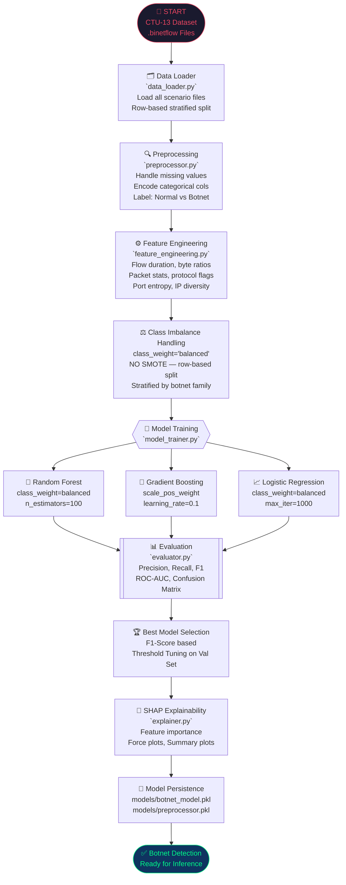
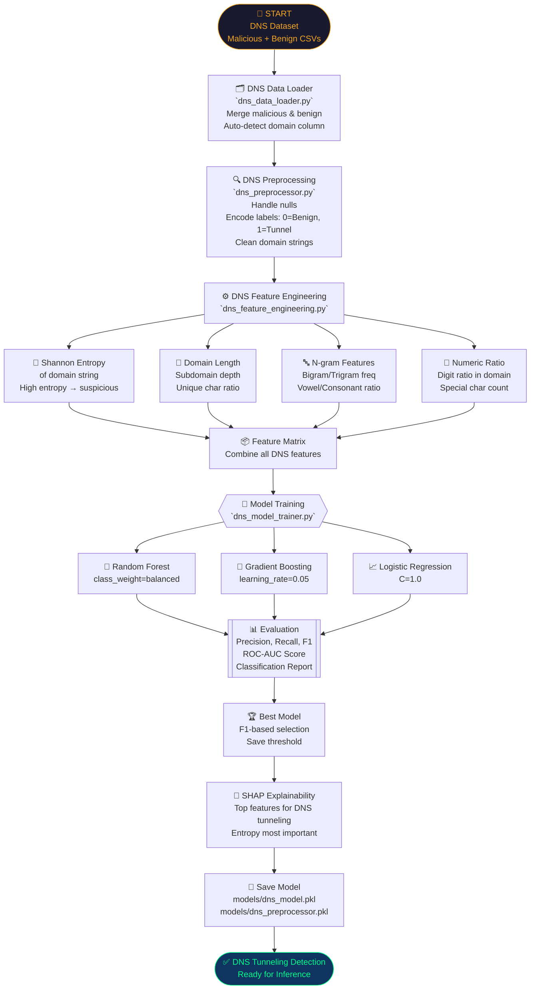
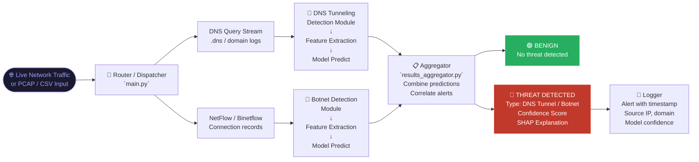
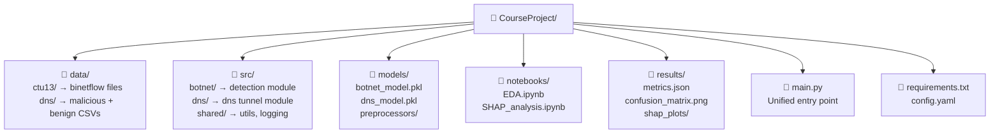

# 🛡️ DNS Tunneling & Botnet Detection — Complete Pipeline Flowchart

> **Project:** ML-Based Network Threat Detection System  
> **Modules:** DNS Tunneling Detection + Botnet Detection (CTU-13)

---

## 🔷 PART 1 — Botnet Detection Pipeline (CTU-13 Dataset)



---

## 🔶 PART 2 — DNS Tunneling Detection Pipeline



---

## 🔁 PART 3 — Unified Inference Pipeline (Combined)



---

## 📁 PART 4 — Project File Structure



---

## 🧠 Key Concepts Summary

| Step | Botnet Detection | DNS Tunneling Detection |
|------|-----------------|------------------------|
| **Dataset** | CTU-13 (binetflow) | Custom DNS CSVs |
| **Split Strategy** | Row-based stratified | Row-based stratified |
| **Key Features** | Flow duration, byte ratio, port entropy | Shannon entropy, domain length, n-grams |
| **Imbalance** | `class_weight='balanced'` | `class_weight='balanced'` |
| **Best Model** | Random Forest / GB | Random Forest / GB |
| **Explainability** | SHAP TreeExplainer | SHAP TreeExplainer |
| **Output** | Normal / Botnet family | Benign / Tunnel |

---

## 🔑 Most Important Feature — Shannon Entropy

```
Entropy(domain) = -Σ p(c) × log₂(p(c))

Normal domain:  "google.com"    → Entropy ≈ 2.8  ✅ Low
Tunnel domain:  "aB3xY9mK2pL.evil.com" → Entropy ≈ 4.9  🚨 HIGH
```

> **Rule of thumb:** Entropy > 3.5 for subdomain → suspicious DNS tunneling activity

---

*Generated for: ML-Based Network Threat Detection | CTU-13 + DNS Dataset*
